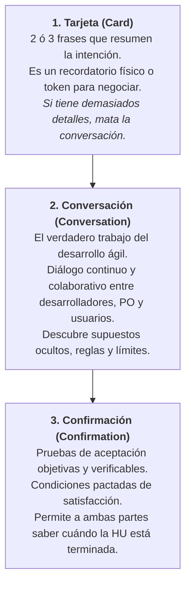
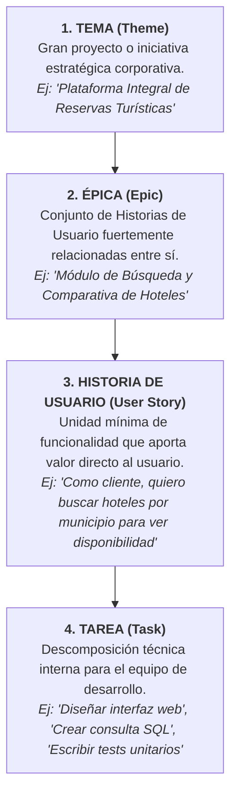
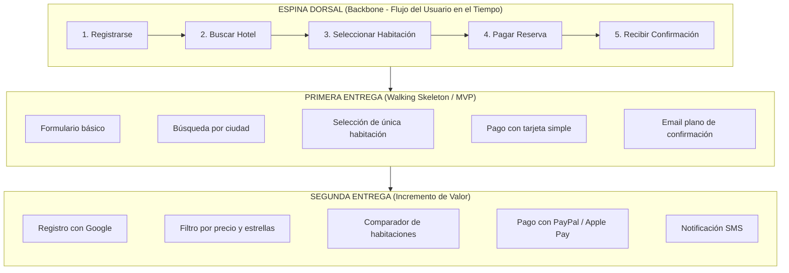
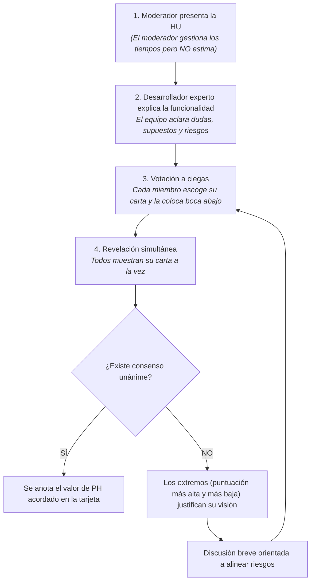
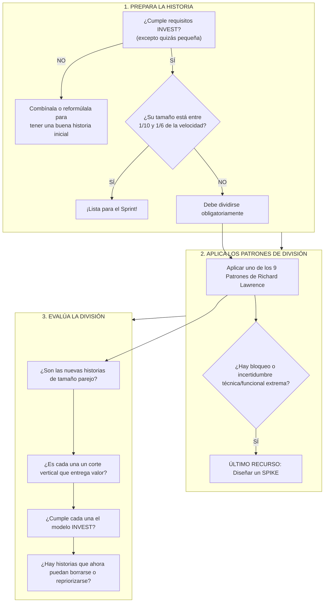

# 📋 Metodologías de Desarrollo Ágil (MDA) — UGR
## 📖 Seminario 2: Historias de Usuario (HU)
**Docente:** Marisa | **Departamento:** Lenguajes y Sistemas Informáticos | **Universidad de Granada**  
**Objetivo de la prueba:** Preparación para el primer examen parcial (preguntas cortas y ejercicios prácticos).

---

# 📑 Índice General de Contenidos

1. [Bloque 1: Fundamentos y Concepto de Historia de Usuario](#bloque-1-fundamentos-y-concepto-de-historia-de-usuario)
   - 1.1 Definición formal (Kent Beck & Martin Fowler)
   - 1.2 Comunicación y Colaboración
   - 1.3 Qué son vs. Qué NO son las Historias de Usuario
   - 1.4 Gran Comparativa: Casos de Uso (RUP) vs. Historias de Usuario (Ágiles)
2. [Bloque 2: Roles, Autoría y Formato Canónico](#bloque-2-roles-autoría-y-formato-canónico)
   - 2.1 ¿Quién escribe las Historias de Usuario? (XP vs. Scrum vs. Realidad)
   - 2.2 Modelado de Roles y Técnicas de Identificación
   - 2.3 Formato Canónico de una HU (Plantilla de Bloques LEGO)
   - 2.4 Catálogo de Ejemplos por Rol de Negocio
3. [Bloque 3: Anatomía de una HU — Las 3 "C" y la Tarjeta Física](#bloque-3-anatomía-de-una-hu--las-3-c-y-la-tarjeta-física)
   - 3.1 El Modelo de las Tres "C" (Ron Jeffries)
   - 3.2 Estructura Canónica de la Tarjeta Física (Anverso y Reverso)
   - 3.3 La Conversación como Fuente de Requisitos Emergentes
   - 3.4 Confirmación: Pruebas de Aceptación y Formato BDD (Given-When-Then)
   - 3.5 Criterios de Aceptación vs. Pruebas Unitarias
4. [Bloque 4: Calidad y Madurez — Criterios INVEST y Definition of Done (DoD)](#bloque-4-calidad-y-madurez--criterios-invest-y-definition-of-done-dod)
   - 4.1 El Modelo I.N.V.E.S.T. (Bill Wake)
   - 4.2 Definición de Terminado (*Definition of Done* - DoD)
   - 4.3 Diferencia Crítica: Criterios de Aceptación vs. DoD
5. [Bloque 5: Jerarquía de Requisitos y Gestión de No Funcionales](#bloque-5-jerarquía-de-requisitos-y-gestión-de-no-funcionales)
   - 5.1 Pirámide de Granularidad: Temas, Épicas, Historias y Tareas
   - 5.2 Descomposición de Historias en Tareas Técnicas
   - 5.3 Tratamiento de los Requisitos No Funcionales (RNF) en Metodologías Ágiles
6. [Bloque 6: Priorización, Estimación y Planificación](#bloque-6-priorización-estimación-y-planificación)
   - 6.1 El Product Backlog y Mapas de Historias de Usuario (*User Story Mapping*)
   - 6.2 Criterios de Priorización y Método MoSCoW
   - 6.3 Estimación Relativa: Puntos de Historia (PH), Días Ideales y Cono de Incertidumbre
   - 6.4 Dinámica del *Planning Poker* (El Juego de la Planificación)
   - 6.5 Velocidad del Equipo: Métodos de Cálculo y Factor de Dedicación
   - 6.6 Planificación de Iteraciones (*Iteration Planning*)
7. [Bloque 7: Patrones de Descomposición de Historias Grandes y SPIKES](#bloque-7-patrones-de-descomposición-de-historias-grandes-y-spikes)
   - 7.1 El Algoritmo de Descomposición (Richard Lawrence / Agile For All)
   - 7.2 Los 9 Patrones Universales para Dividir Historias
   - 7.3 SPIKE: Definición, Clasificación Técnica/Funcional y las 5 Reglas de Oro
8. [Bloque 8: Cuaderno de Ejercicios Prácticos Resueltos (Paso a Paso)](#bloque-8-cuaderno-de-ejercicios-prácticos-resueltos-paso-a-paso)
   - Ejercicio 1: Redacción de Tarjeta Canónica con Criterios de Aceptación
   - Ejercicio 2: Conversión a Formato BDD (Given-When-Then)
   - Ejercicio 3: Auditoría y Refactorización con Criterios INVEST
   - Ejercicio 4: Cálculo Matemático de Velocidad con Factor de Dedicación
   - Ejercicio 5: Planificación Óptima de Iteraciones según Velocidad
   - Ejercicio 6: Descomposición de HU "Gestionar Usuarios (13 PH)"
   - Ejercicio 7: Repriorización Vertical tras Descomposición por Variación de Datos
   - Ejercicio 8: Identificación y Formulación de un SPIKE Técnico y Funcional
9. [Bloque 9: Banco de Preguntas Cortas de Examen (Con Respuesta Razonada)](#bloque-9-banco-de-preguntas-cortas-de-examen-con-respuesta-razonada)

---

# Bloque 1: Fundamentos y Concepto de Historia de Usuario

## 1.1 Definición formal (Kent Beck & Martin Fowler)

> *"The story is the unit of functionality in an XP project. We demonstrate progress by delivering tested, integrated code that implements a story. A story must be understandable to customers, developer-testable, valuable to the customer, and small enough that programmers can build half a dozen in an iteration."*  
> — **Kent Beck & Martin Fowler**, *Planning Extreme Programming*.

De esta definición canónica se desprenden los cuatro pilares esenciales:
1. **Unidad mínima de funcionalidad:** En métodos ágiles no se mide el progreso por líneas de código escritas ni por páginas de especificación aprobadas, sino por software probado e integrado que implementa una historia.
2. **Comprensible para el cliente:** Escrita sin jerga técnica interna, en el lenguaje del dominio del problema.
3. **Probable por los desarrolladores (*developer-testable*):** Debe ser verificable de forma determinista mediante pruebas de aceptación objetivas.
4. **Tamaño acotado:** Lo suficientemente pequeña para que un equipo pueda construir e integrar varias de ellas (típicamente entre 4 y 10) en el transcurso de una única iteración (*Sprint*).


## 1.2 Comunicación y Colaboración

Una Historia de Usuario se define formalmente como:
* Una **corta declaración de intención** que describe algo que el sistema necesita hacer para el usuario.
* Una **descripción simple de una tarea concreta** que aporta valor medible al usuario o al negocio.
* El resultado de reuniones periódicas y colaborativas con los *stakeholders* (partes interesadas).

> [!IMPORTANT]
> **El Objetivo Primordial:**  
> El propósito de las HU es **lograr la interacción y el diálogo continuo entre el equipo de desarrollo y el usuario/cliente**, situando esta colaboración activa **muy por encima de documentar exhaustivamente los requisitos**. Las HU no sustituyen la conversación; existen precisamente para provocarla.

## 1.3 Qué son vs. Qué NO son las Historias de Usuario

Para no cometer errores en las preguntas conceptuales de examen:

| Lo que **SÍ ES** una Historia de Usuario | Lo que **NO ES** una Historia de Usuario |
| :--- | :--- |
| **Una promesa de una conversación** futura entre el equipo y el usuario para detallar el comportamiento. | **No es una especificación cerrada o detallada** donde todo esté prefijado desde el primer día. |
| **Una necesidad del usuario** expresada en su propio lenguaje. | **No es un requisito tradicional de software** redactado como una directiva rígida de ingeniería. |
| **Un elemento negociable:** *"Necesitaríamos hacer algo similar a esto..."*, sujeto a ajuste según coste/beneficio. | **No es una obligación contractual inmutable:** *"El sistema deberá obligatoriamente realizar X bajo cualquier circunstancia"*. |
| **Un instrumento de planificación** ágil y estimación de velocidad. | **No es un documento de archivo** destinado a almacenarse en carpetas sin uso operativo cotidiano. |

---

## 1.4 Gran Comparativa: Casos de Uso (RUP) vs. Historias de Usuario (Ágiles)

> [!TIP]
> Esta tabla comparativa es una de las preguntas de teoría más recurrentes. Domina cada una de las dimensiones comparadas:

| Dimensión | Casos de Uso (RUP / Tradicional) | Historias de Usuario (XP / Scrum / Ágil) |
| :--- | :--- | :--- |
| **Objetivo** | Modelar exhaustivamente la interacción formal entre un actor y el sistema informático. | Redactar una descripción breve de una funcionalidad tal y como la percibe y valora el usuario. |
| **Estructura** | Plantillas densas, predefinidas, de múltiples páginas con precondiciones, postcondiciones, flujos alternativos y conceptos técnicos. | 1 ó 2 frases cortas y consistentes escritas exclusivamente en el lenguaje natural del usuario. |
| **Planificación** | **No se utilizan para planificar** el trabajo diario ni el avance temporal por su excesiva granularidad o desfase. | **Se utilizan directamente para planificar** iteraciones, estimar velocidad y calcular entregas. |
| **Agilidad** | Requieren un prolongado periodo previo de análisis y redacción formal de plantillas. | Se pueden escribir, evaluar o replantear en **pocos minutos**. |
| **Comprensión** | De difícil lectura y asimilación para clientes y usuarios de negocio; a menudo confusas incluso para personal técnico. | **Fáciles de leer y comprender** por cualquier participante sin formación técnica. |
| **Mantenimiento**| Documentos extensos (cientos de páginas) muy costosos y lentos de mantener actualizados ante cambios. | **Extremadamente fáciles de mantener**; si una historia ya no aporta valor, simplemente se descarta o reescribe. |
| **Comunicación** | Basada en modelos textuales exhaustivos y diagramas UML: *todo lo necesario tiene que estar escrito*. | Basada en la **comunicación verbal directa**, orientada a la colaboración continua y la discusión para resolver dudas. |
| **Soporte físico** | Archivos digitales y memorias extensas creados con la expectativa de ser archivados como referencia contractual. | **Tarjetas físicas o paneles visuales (Kanban/Jira)** diseñados para manipularse y moverse directamente durante el Sprint. |
| **Duración** | Suelen abarcar flujos complejos que pueden requerir **múltiples iteraciones** para ser completados. | **Deben ser implementadas, probadas e integradas en una única iteración**; nunca superan el límite del Sprint. |
| **Autoría** | Redactados casi exclusivamente por analistas de sistemas, consultores y arquitectos de software. | Redactadas o co-creadas directamente por **usuarios, clientes y el Product Owner** en colaboración con el equipo. |
| **Pruebas** | La estrategia y casos de prueba se redactan en planes de pruebas independientes y separados del caso de uso. | Llevan sus propias **pruebas de aceptación escritas en el reverso de la misma tarjeta**. |
| **Visión global**| Proporcionan una visión arquitectónica panorámica y la integración global del sistema. | Proporcionan una visión más granular y puntual, por lo que **el feedback continuo y las pruebas de usuario son indispensables**. |
| **Metodología** | Asociado históricamente a **RUP (Rational Unified Process)** y procesos formales en cascada/espiral. | Asociado a **Programación Extrema (XP)** y **Scrum**. |

---

# Bloque 2: Roles, Autoría y Formato Canónico

## 2.1 ¿Quién escribe las Historias de Usuario?

La autoría de una Historia de Usuario varía según el marco de trabajo considerado:
* **En Programación Extrema (XP):** El **Cliente** (*On-site Customer*). Es quien se sienta junto a los desarrolladores y posee la máxima autoridad funcional.
* **En Scrum:** El **Product Owner (PO)** es el responsable último de gestionar y nutrir el *Product Backlog*, apoyándose en clientes, usuarios, *stakeholders* y el equipo de desarrollo.
* **En la Práctica Real de la Industria:** **Cualquier miembro del equipo de desarrollo** que posea conocimiento suficiente del dominio del problema puede redactar una HU para su posterior revisión y priorización.

### El "Customer Team" (Equipo de Cliente)
Para garantizar que las HU cubran las necesidades reales de negocio sin sesgos, deben redactarse y refinarse mediante la participación de un equipo multidisciplinar:
1. **Clientes reales y usuarios finales:** Expresan sus dolores y necesidades operativas diarias.
2. **Product Manager / Product Owner:** Custodia la visión estratégica y el retorno de inversión.
3. **Probadores (Testers / QA):** Aportan la visión crítica sobre verificabilidad, casos límite y criterios de aceptación.
4. **Diseñadores de interacción (UX / UI):** Aportan usabilidad, accesibilidad y flujos ergonómicos de trabajo.

---

## 2.2 Modelado de Roles y Técnicas de Identificación

Para no caer en el error de redactar todas las historias para un genérico "usuario", el equipo debe caracterizar a los diferentes actores del sistema.

### Dinámica de Identificación
1. **Sesión de Brainstorming:** Listar todos los posibles perfiles que interactúan directa o indirectamente con el software.
2. **Definición de Perfiles:** Determinar para cada rol:
   - Frecuencia habitual de uso (diaria, esporádica, puntual).
   - Objetivos y metas que se plantean al entrar en el sistema.
   - Vía de acceso habitual (móvil, navegador de escritorio, API externa, terminal administrativo).
   - Grado de experiencia técnica o en el negocio.

### Ejemplo de Roles de Sistema (Portal de Gestión Turística / Agencia de Viajes):
* **Cliente:** Busca hoteles, compara ofertas, formaliza y cancela reservas.
* **Socio / Cliente Habitual:** Disfruta de descuentos por fidelidad, historial acumulado y gestión de puntos.
* **Planificador de Viajes:** Requiere galerías de fotos exhaustivas, validación de instalaciones y análisis de satisfacción para terceros.
* **Comentarista:** Publica opiniones, valoraciones y fotografías tras su estancia.
* **Afiliado / Partner:** Gestiona enlaces de referidos y consulta comisiones devengadas.
* **Hotel / Proveedor:** Publica disponibilidad, modifica cupos de habitaciones y actualiza tarifas estacionales.
* **Agencia de Viajes Externa:** Realiza reservas agrupadas y consulta condiciones para mayoristas.
* **Administrador del Sistema:** Da de alta proveedores, audita transacciones y gestiona accesos.
* **Social Media Manager:** Analiza tendencias y conecta promociones con redes sociales.
* **Publicista / Responsable de Marketing:** Configura campañas publicitarias y banners promocionales.

---

## 2.3 Formato Canónico de una HU (Plantilla de Bloques LEGO)

El estándar de facto en desarrollo ágil es la plantilla de tres cláusulas:

$$\mathbf{Como\ [rol], \quad Quiero\ [característica/actividad], \quad Para\ [valor\ de\ negocio/beneficio]}$$


### Componentes Explicados:
* **`Como [rol]` (Quién):** Identifica qué tipo de usuario se beneficia de la función. Jamás debe usarse simplemente "Como usuario", sino el perfil específico (*"Como cliente no registrado"*, *"Como administrador contable"*).
* **`Quiero [característica]` (Qué):** Representa la actividad que el rol desea realizar. Es el eje funcional de la historia.
* **`Para [beneficio]` (Por qué):** Es el elemento más valioso y frecuentemente olvidado. Justifica la existencia de la historia ante el negocio. Si una historia carece de un *"Para"* que aporte valor tangible, la historia no debería construirse.

---

## 2.4 Catálogo de Ejemplos por Rol de Negocio

### Ejemplos en Web de Alojamientos y Viajes:
1. *Reserva Básica:*
   > **Como** cliente, **quiero** reservar una habitación de hotel **para** garantizar mi estancia durante mis fechas de viaje y planificar mi viaje con tranquilidad.
2. *Cancelación:*
   > **Como** cliente, **quiero** cancelar una reserva previa **para** realizar una nueva reserva en fechas o destinos diferentes que se adapten mejor a mi agenda sin perder dinero.
3. *Búsqueda Especializada:*
   > **Como** cliente, **quiero** buscar hoteles cerca del mar **para** disfrutar de acceso rápido y cómodo a la playa.
4. *Filtros de Negocio:*
   > **Como** cliente, **quiero** filtrar los hoteles en los que admiten mascotas **para** descartar rápidamente alojamientos que no acepten animales y no perder tiempo revisando fichas innecesarias.
5. *Comparativa:*
   > **Como** cliente, **quiero** comparar las características y precios de dos hoteles **para** evaluar cuál de ellos ofrece la mejor relación calidad-precio según mi presupuesto.
6. *Perfil Profesional:*
   > **Como** planificador de viajes, **quiero** ver fotografías detalladas de las instalaciones del hotel **para** verificar la calidad de las habitaciones y asegurarme de que cumple con las expectativas de mis clientes antes de reservar.

---

# Bloque 3: Anatomía de una HU — Las 3 "C" y la Tarjeta Física

## 3.1 El Modelo de las Tres "C" (Ron Jeffries)

Propuesto por **Ron Jeffries** (uno de los padres de Extreme Programming), este marco resume los tres componentes indisolubles de toda Historia de Usuario:



---

## 3.2 Estructura Canónica de la Tarjeta Física (Anverso y Reverso)

En un soporte físico (tarjeta de cartulina o ficha de índice de $7.5 \times 12.5\text{ cm}$), la información se reparte con estricta disciplina pedagógica:

```
┌────────────────────────────────────────────────────────────────────────┐
│ ANVERSO DE LA TARJETA                                                  │
├────────────────────────────────────────────────────────────────────────┤
│ ID: 5                     TÍTULO: Préstamo de Libro                    │
│                                                                        │
│ DESCRIPCIÓN (Narrativa Canónica):                                      │
│ Como socio de la biblioteca, quiero solicitar en préstamo un libro     │
│ indicando mi código de socio y la referencia del libro, para poder     │
│ leerlo en mi domicilio durante el periodo autorizado.                  │
│                                                                        │
│ ESTIMACIÓN: 4 PH (Puntos de Historia)                                  │
│ PRIORIDAD:  300 (Valor de negocio relativo)                            │
│ DEPENDENCIAS: HU-01 (Alta de socios), HU-02 (Catálogo de libros)       │
└────────────────────────────────────────────────────────────────────────┘

┌────────────────────────────────────────────────────────────────────────┐
│ REVERSO DE LA TARJETA                                                  │
├────────────────────────────────────────────────────────────────────────┤
│ PRUEBAS DE ACEPTACIÓN (Criterios de Verificación):                     │
│                                                                        │
│ [ ] 1. Introducir un número de socio inexistente y comprobar que el    │
│        sistema muestra un mensaje de error descriptivo y bloquea.      │
│ [ ] 2. Introducir un socio que ya posee 3 libros en préstamo activo y  │
│        comprobar que el sistema deniega el préstamo por cupo agotado.  │
│ [ ] 3. Introducir un libro del que hay 0 ejemplares disponibles y      │
│        comprobar que el sistema rechaza la solicitud e informa.        │
│ [ ] 4. Introducir todos los datos válidos y comprobar que:             │
│        - Los ejemplares disponibles del libro se decrementan en 1.     │
│        - El contador de préstamos activos del socio aumenta en 1.      │
│        - Se registra la fecha máxima límite de devolución.             │
└────────────────────────────────────────────────────────────────────────┘
```

---

## 3.3 La Conversación como Fuente de Requisitos Emergentes

> *"La tarjeta no contiene todas las respuestas; su propósito fundamental es PROVOCAR las preguntas adecuadas."*

Tomemos la historia: *"Como cliente, quiero cancelar una reserva de hotel"*.  
Durante la fase de **Conversación**, el equipo y el cliente exploran los casos no explícitos:
* *¿Qué coste o penalización económica conlleva la cancelación?*
* *¿Todos los niveles de clientes (estándar, premium, corporativo) tienen la misma penalización?*
* *¿Se puede cancelar en cualquier momento o existe un límite de horas previas al check-in?*
* *¿Se admite cancelación parcial (anular una de tres habitaciones reservadas) o solo total?*
* *¿A quién se notifica automáticamente por correo (al cliente, al departamento de recepción, a la central de reservas)?*

---

## 3.4 Confirmación: Pruebas de Aceptación y Formato BDD (Given-When-Then)

Las pruebas o criterios de aceptación son las **condiciones de satisfacción que una HU debe satisfacer obligatoriamente para considerarse apta para despliegue**.

### Propiedades de las Pruebas de Aceptación:
1. **Propiedad del Product Owner:** Aunque cualquiera en el equipo puede redactarlas o enriquecerlas, el PO es el responsable y propietario final.
2. **Pruebas de Caja Negra (*Black-box*):** Solo verifican entradas y salidas del sistema observables por el usuario; no les interesa el código interno ni cómo se calculan los resultados.
3. **Independencia de la Implementación:** Describen **QUÉ** debe ocurrir, jamás **CÓMO** está programado (no se menciona SQL, nombres de variables o tablas de BD).
4. **Desarrollo en el mismo Sprint:** Se especifican y automatizan **en la misma iteración** en la que se programa el código de la historia.

### Formato BDD (*Behavior-Driven Development*):
Estructura estándar promovida por Dan North:
* **Dado (*Given*):** El contexto o precondición inicial del sistema.
* **Cuando (*When*):** La acción, evento o estímulo desencadenante provocado por el usuario.
* **Entonces (*Then*):** La postcondición o resultado observable del sistema.

#### Ejemplo Canónico de BDD:
```gherkin
Escenario: Intento de registro con identificador duplicado
  DADO un sistema donde ya existe un usuario registrado con el nombre "idprueba"
  CUANDO un nuevo visitante intenta registrarse utilizando el nombre "idprueba"
  ENTONCES el sistema deniega el registro y muestra un mensaje indicando que el nombre "idprueba" ya está en uso.
```

---

## 3.5 Criterios de Aceptación vs. Pruebas Unitarias

| Criterio | Pruebas de Aceptación (Confirmación de HU) | Pruebas Unitarias (Técnicas) |
| :--- | :--- | :--- |
| **Audiencia** | Product Owner, usuarios, analistas y equipo. | Desarrolladores y equipo técnico. |
| **Nivel** | Nivel funcional del sistema (Caja Negra). | Nivel de clase, función o método (Caja Blanca). |
| **Lenguaje** | Lenguaje de negocio o lenguaje natural estructurado (Gherkin BDD). | Lenguaje de programación (JUnit, Jest, PyTest, etc.). |
| **Propósito** | Validar que se ha construido el producto *correcto* (valor para el negocio). | Validar que el código se ha construido *correctamente* (sin regresiones lógicas). |

---

# Bloque 4: Calidad y Madurez — Criterios INVEST y Definition of Done (DoD)

## 4.1 El Modelo I.N.V.E.S.T. (Bill Wake)

Creado por **Bill Wake**, es el acrónimo mnemotécnico universal para evaluar si una Historia de Usuario está bien formulada:

| Letra | Principio | Significado Pedagógico | ¿Cómo detectarlo y solucionarlo? |
| :---: | :--- | :--- | :--- |
| **I** | **Independiente** (*Independent*) | La historia debe poder implementarse, probarse y entregarse sin depender rígidamente de otras historias del backlog. | Si la historia A requiere que la historia B esté terminada previamente, combínalas o busca una división perpendicular que rompa el acoplamiento. |
| **N** | **Negociable** (*Negotiable*) | No es un contrato legal cerrado. Los detalles son flexibles y se ajustan durante la conversación según coste, tiempo y tecnología. | Si una historia impone una solución técnica rígida (*"Deberá usarse una tabla SQL con 8 campos..."*), elimine la imposición técnica y describa el objetivo de negocio. |
| **V** | **Valiosa** (*Valuable*) | Debe entregar un valor de negocio medible o perceptible al usuario final o al comprador del producto. | Evitar historias puramente técnicas como *"Crear índices en la BD"*. Redáctela orientada al usuario: *"Optimizar el tiempo de respuesta del buscador para evitar esperas"*. |
| **E** | **Estimable** (*Estimable*) | El equipo de desarrollo debe comprenderla lo suficiente para pronosticar su esfuerzo relativo y complejidad. | Si el equipo responde con dudas extremas o vota $\infty$ en Planning Poker, falta información técnica: debe emitirse un **SPIKE** previo de investigación. |
| **S** | **Small / Suscinta** (*Small*) | Debe ser lo bastante pequeña para ser completada con holgura por 2-3 programadores en unos pocos días (máx. 1 Sprint). | Si supera $1/10$ o $1/6$ de la velocidad global del equipo, es una Épica y debe descomponerse obligatoriamente usando patrones de división. |
| **T** | **Testeable** (*Testable*) | Debe poseer criterios objetivos que permitan redactar pruebas de aceptación que pasen o fallen inequívocamente. | Si el criterio dice *"El sistema debe ser rápido y amigable"*, cámbielo por una métrica objetiva: *"El tiempo de respuesta del servidor será inferior a 1,5 segundos"*. |

---

## 4.2 Definición de Terminado (*Definition of Done* - DoD)

> [!IMPORTANT]
> **Definición:** La **Definition of Done (DoD)** es un **acuerdo formal de estándares de calidad** pactado entre el equipo de desarrollo y el Product Owner. Establece la lista de verificación que toda funcionalidad debe cumplir para considerarse apta para su puesta en producción sin deuda técnica.

### Elementos habituales que integran una DoD rigurosa:
1. **Batería de pruebas superada:** Pruebas unitarias ejecutadas al 100%, pruebas de integración completadas y cobertura de código mínima alcanzada (ej. $\ge 80\%$).
2. **Revisión de código (*Code Review*):** Código revisado por pares mediante *Pull Request*, aprobado y libre de incidencias críticas o advertencias del linter.
3. **Entorno de verificación:** El software ha sido desplegado y verificado con éxito en el entorno acordado (Staging / Preproducción / Pruebas).
4. **Documentación técnica y de usuario:** Código comentado, manual de usuario o guías de ayuda actualizadas y documentación de APIs (Swagger/OpenAPI) generada.
5. **Criterios de aceptación satisfechos:** Todos y cada uno de los tests de aceptación del reverso de la tarjeta han sido ejecutados y validados positivamente por el Product Owner.

---

## 4.3 Diferencia Crítica: Criterios de Aceptación vs. DoD

* **Criterios de Aceptación:** Son **específicos para CADA historia de usuario**. Verifican las reglas particulares del negocio (ej. *"Se aplica un 10% de recargo si cancela el mismo día"*).
* **Definition of Done (DoD):** Es **común y transversal a TODAS las historias del producto** (o a un conjunto amplio de ellas). Garantiza los estándares de ingeniería y calidad técnica (ej. *"Pasa todos los tests unitarios y la revisión de código"*).

---

# Bloque 5: Jerarquía de Requisitos y Gestión de No Funcionales

## 5.1 Pirámide de Granularidad: Temas, Épicas, Historias y Tareas

El desarrollo ágil estructura las necesidades desde visiones estratégicas de negocio hasta instrucciones operativas de código:



### Características Temporales y Operativas de Cada Nivel:
* **Tema:** Peticiones globales de alto nivel. Abarca meses o múltiples trimestres.
* **Épica:** Demasiado grande para entrar en un único Sprint; debe desglosarse en varias HU.
* **Historia de Usuario:** Se completa en el transcurso de **días o como máximo 1-2 semanas** (siempre dentro de 1 Sprint).
* **Tarea:** Tarea técnica individual realizada por un programador. Su duración debe oscilar entre **medio día (4 horas) y un máximo de 3 a 4 días de trabajo**.

---

## 5.2 Descomposición de Historias en Tareas Técnicas

Una Historia de Usuario representa una porción vertical de valor; las **tareas** representan el trabajo horizontal de ingeniería necesario para completarla:

### Ejemplo Real de Descomposición en Tareas:
**HU:** *"Como administrador, quiero realizar el mantenimiento de los clientes de la empresa para tener sus datos actualizados."*

**Desglose en Tareas Técnicas (Backlog del Sprint):**
1. [ ] *Tarea 1:* Diseñar y maquetar la interfaz de usuario (IU) del formulario de edición y listado.
2. [ ] *Tarea 2:* Construir los servicios de lógica de negocio y validación de reglas de datos.
3. [ ] *Tarea 3:* Implementar las operaciones de persistencia en base de datos (capa DAO/Repository).
4. [ ] *Tarea 4:* Codificar el endpoint para "Añadir nuevo cliente".
5. [ ] *Tarea 5:* Codificar el endpoint para "Modificar datos de cliente existente".
6. [ ] *Tarea 6:* Codificar el endpoint para "Eliminar/Desactivar cliente".
7. [ ] *Tarea 7:* Desarrollar los tests unitarios automatizados de cada endpoint.
8. [ ] *Tarea 8:* Realizar pruebas de aceptación integradas de extremo a extremo.

---

## 5.3 Tratamiento de los Requisitos No Funcionales (RNF) en Metodologías Ágiles

Los Requisitos No Funcionales describen atributos de calidad, rendimiento, seguridad o restricciones del entorno. En el desarrollo ágil se gestionan de **cinco formas complementarias**:

1. **Como Restricción asignada a cualquier elemento:** Restricción asociada a un Tema, Épica, HU o Tarea.
2. **Como Criterio de Aceptación dentro de una HU:**  
   *Ejemplo:* HU: *"Como analista, quiero ver las transacciones mensuales..."*  
   *Criterio de aceptación:* *"El sistema mostrará todas las transacciones en menos de 10 segundos para un histórico de 1000 movimientos"*.
3. **Como elemento transversal en la Definition of Done (DoD):**  
   *Ejemplo:* *"Ninguna petición al servidor podrá demorarse más de 2 segundos en responder en el entorno de preproducción"*.
4. **Redactado directamente como una Historia de Usuario propia:**  
   *Ejemplo:* *"Como comprador, quiero que la tienda online esté disponible el 98% de las ocasiones en que acceda para poder finalizar mis compras sin interrupciones"*.
5. **Documento de especificación de requisitos no funcionales globales:** Para restricciones corporativas de hardware, auditoría legal o normativas de privacidad (ej. RGPD).

---

# Bloque 6: Priorización, Estimación y Planificación

## 6.1 El Product Backlog y Mapas de Historias de Usuario (*User Story Mapping*)

El **Product Backlog** es la lista priorizada y dinámica de todas las funcionalidades, mejoras y correcciones que conforman el producto.

### User Story Mapping (Jeff Patton)
Técnica visual creada por Jeff Patton para evitar que el Product Backlog sea una simple lista plana unidimensional donde se pierde el contexto del flujo del usuario:



* **Eje Horizontal (Tiempo / Flujo del Usuario):** Las actividades esenciales secuenciales de izquierda a derecha (*Backbone*).
* **Eje Vertical (Necesidad / Prioridad / Opcionalidad):** En la parte superior se sitúan las historias críticas indispensables; hacia abajo, las extensiones y variaciones opcionales.
* **Cortes Horizontales (*Slices*):** Definen las entregas (*Releases*):
  - **Release 1 (*Walking Skeleton* o MVP):** El esqueleto funcional mínimo que permite recorrer todo el flujo de inicio a fin.
  - **Release 2, 3...:** Versiones sucesivas con mayor riqueza funcional y sofisticación.

---

## 6.2 Criterios de Priorización y Método MoSCoW

### Factores Determinantes de la Prioridad:
1. **Valor de Negocio para el Cliente:** Beneficio económico, captación de clientes o ahorro de costes.
2. **Impacto en los Usuarios:** Diferenciar entre historias de valor para *muchos usuarios estándar* vs. valor crítico para *pocos usuarios clave*.
3. **Riesgo e Incertidumbre:** Abordar temprano las historias con alto riesgo tecnológico para mitigarlo cuanto antes.
4. **Dependencias Técnicas:** Requisitos previos indispensables.
5. **Tamaño y Esfuerzo Relativo:** Historias pequeñas con alto retorno suelen priorizarse antes (*Quick Wins*).

> [!WARNING]
> **REGLA DE ORO DE EXAMEN:**  
> **"La prioridad puede cambiar a lo largo del proyecto; el tamaño NO."**  
> El esfuerzo técnico inherente a una funcionalidad no se reduce por ser más o menos urgente; lo que cambia dinámicamente es cuándo decide el cliente construirla.

### Método MoSCoW:
* **M - Must have (Obligatorias):** Sin ellas el sistema no puede salir a producción bajo ningún concepto (Entrega 1).
* **S - Should have (Deberían incluirse):** Muy importantes; deben completarse por todos los medios, pero el éxito básico no depende de ellas a corto plazo.
* **C - Could have (Podrían incluirse):** Deseables si sobra tiempo o presupuesto; se incorporan si no comprometen las fechas de entrega.
* **W - Won't have / Would have (No se construirán ahora):** Descartadas para la versión actual por restricciones de tiempo/coste; se posponen a versiones futuras.

---

## 6.3 Estimación Relativa: Puntos de Historia (PH), Días Ideales y Cono de Incertidumbre

* **Puntos de Historia (PH):** Unidad de medida **relativa** y abstracta que evalúa el tamaño de una historia en comparación con otras ya conocidas por el mismo equipo. Engloba tres variables simultáneas:
  $$\mathbf{Puntos\ de\ Historia} = f(\text{Esfuerzo necesario}, \ \text{Complejidad técnica}, \ \text{Riesgo e Incertidumbre})$$
* **Días Ideales:** Tiempo de programación neta sin interrupciones, correos ni reuniones.

### El Cono de Incertidumbre
Al inicio de un proyecto, la dispersión en las estimaciones puede variar en un factor de $4\times$ (entre el 25% y el 400% del tiempo real). Conforme el equipo entrega software y comprende el dominio, el cono se estrecha hasta converger en predicciones precisas.

---

## 6.4 Dinámica del *Planning Poker* (El Juego de la Planificación)

Técnica de estimación colaborativa basada en el consenso para evitar el sesgo cognitivo de **anclaje** (cuando la opinión del miembro más veterano condiciona a los demás):



### Mazo de Cartas de Planning Poker:
Secuencia adaptada de Fibonacci:
$$0, \quad \frac{1}{2}, \quad 1, \quad 2, \quad 3, \quad 5, \quad 8, \quad 13, \quad 20, \quad 40, \quad 100, \quad ?, \quad \text{☕ (Taza de café)}$$
* **`?`:** Incertidumbre total; el desarrollador no comprende la historia (requiere análisis o un Spike).
* **`☕`:** Solicitud de pausa/descanso por saturación.
* **Propósito Real:** No es acertar con un número exacto, sino **desvelar riesgos ocultos y alinear la comprensión mental de todo el equipo**.

---

## 6.5 Velocidad del Equipo: Métodos de Cálculo y Factor de Dedicación

> **Definición:** La **Velocidad** es el número total de **Puntos de Historia (PH)** que un equipo de desarrollo es capaz de completar e integrar satisfactoriamente (cumpliendo la DoD) en el transcurso de una iteración.

### Métodos para Obtener la Velocidad:
1. **Datos Históricos (*Yesterday's Weather*):** Usar la velocidad media lograda en las iteraciones precedentes inmediatas. Es el método más fiable.
2. **Iteración Inicial de Calibración:** Ejecutar el primer Sprint como prueba empírica y tomar su velocidad observada como base de partida.
3. **Pronóstico por Cálculo de Recursos (Modelo Matemático de Examen):**

### 📐 Modelo de Cálculo de Recursos (Slide 77):
$$\text{Días de trabajo brutos} = \text{Programadores} \times \text{Días laborables del Sprint}$$
$$\text{Capacidad Teórica} = \text{Días brutos} \times 1\text{ PH/día ideal}$$
$$\mathbf{Velocidad\ Real\ Estimada} = \text{Capacidad Teórica} \times \mathbf{Factor\ de\ Dedicación}$$

#### Ejemplo Numérico Canónico de Clase:
* Equipo: $5\text{ miembros}$.
* Iteración: $2\text{ semanas} = 10\text{ días laborables}$.
* Equivalencia estimada: $1\text{ PH} = 1\text{ día ideal de trabajo}$.
* Factor de dedicación considerado: $80\%$ (el $20\%$ restante se absorbe en reuniones, soporte y descansos).

$$\text{Días de trabajo por iteración} = 5 \times 10 = 50\text{ días}$$
$$\mathbf{Velocidad} = 50 \times 0.80 = \mathbf{40\ PH\ por\ iteración}$$

---

## 6.6 Planificación de Iteraciones (*Iteration Planning*)

Una vez fijada la velocidad, las Historias de Usuario se asignan a los Sprints de forma que:
$$\sum \text{PH de las historias del Sprint} \le \text{Velocidad del Equipo}$$

### Ejemplo de Planificación de Clase (Slide 78):
* **Velocidad del equipo:** $13\text{ PH}$.
* **Historias a planificar:**
  $A(3),\ B(5),\ C(5),\ D(3),\ E(1),\ F(8),\ G(5),\ H(5),\ I(5),\ J(2)$.

**Asignación por Iteraciones:**
* **Iteración 1:** $A(3) + B(5) + C(5) = \mathbf{13\ PH} \le 13$ ✅
* **Iteración 2:** $D(3) + E(1) + F(8) = \mathbf{12\ PH} \le 13$ ✅
* **Iteración 3:** $G(5) + H(5) + J(2) = \mathbf{12\ PH} \le 13$ ✅
* **Iteración 4:** $I(5) = \mathbf{5\ PH} \le 13$ ✅

---

# Bloque 7: Patrones de Descomposición de Historias Grandes y SPIKES

## 7.1 El Algoritmo de Descomposición (Richard Lawrence / Agile For All)

Cuando una historia es demasiado grande para ser abordada en un Sprint (viola la "S" de INVEST), se somete al siguiente protocolo en tres fases:



---

## 7.2 Los 9 Patrones Universales para Dividir Historias

> [!IMPORTANT]
> Domina el nombre y la aplicación de los 9 patrones, pues son la base directa de los ejercicios prácticos de examen:

### 1. Pasos de un Flujo de Trabajo (*Workflow Steps*)
Identificar los pasos secuenciales que sigue el usuario e implementar los pasos de forma incremental o construir una loncha fina del inicio y el final, rellenando el medio después.
* *HU Grande:* Como vendedor, quiero publicar los nuevos programas de precios para los clientes.
* *División:*
  1. ...quiero publicar los programas de precios en la página principal web.
  2. ...quiero enviar un mensaje general a cada cliente con los nuevos precios usando el portal.
  3. ...quiero enviar la lista de precios con descuentos personalizados por cliente.

### 2. Reglas de Negocio (*Business Rules Variations*)
Si una historia contiene múltiples condiciones de negocio o casos especiales, aislar la regla básica y crear historias separadas para cada regla adicional o excepción.
* *HU Grande:* Como cliente bancario, quiero retirar dinero de un cajero para tener efectivo.
* *División:*
  1. ...quiero retirar dinero verificando que la cuenta no quede en saldo negativo.
  2. ...quiero estar limitado a un retiro máximo de 1.000 € diarios por seguridad.

### 3. Mayor Esfuerzo de Desarrollo (*Major Effort*)
Cuando una historia agrupa varias alternativas similares, la primera de ellas absorberá la mayor parte del esfuerzo porque implica levantar la infraestructura técnica o framework base; las siguientes serán incrementos pequeños.
* *HU Grande:* Como usuario, quiero cambiar la tarifa de electricidad aplicada desde el selector web.
* *División:*
  1. ...quiero seleccionar la tarifa basada en medida de uso (absorbe la conexión al backend de tarifas).
  2. ...quiero seleccionar la tarifa de prepago (reutiliza el mecanismo ya construido).
  3. ...quiero seleccionar tarifas con descuento promocional.

### 4. Sencillo / Complejo (*Simple / Complex*)
Cuando una funcionalidad amenaza con volverse infinita, preguntarse: *¿Qué es lo más simple que podría funcionar?* Se construye el núcleo y se deja la sofisticación para historias posteriores.
* *HU Grande:* Como usuario, quiero tener siempre el precio más bajo de un producto.
* *División:*
  1. ...mostrando directamente el precio más bajo del proveedor actual.
  2. ...avisando de posibles ofertas que aparecerán en el futuro próximo.

### 5. Variaciones en Datos (*Data Variations*)
La complejidad a menudo proviene de admitir múltiples formatos, codificaciones, idiomas o fuentes de datos.
* *HU Grande:* Como administrador, quiero enviar comunicados a los clientes.
* *División:*
  1. ...enviando los comunicados exclusivamente en español.
  2. ...enviando los comunicados en inglés y otros idiomas.

### 6. Métodos de Entrada de Datos / Vistas de la Interfaz (*Interface Methods*)
La dificultad radica a menudo en la interfaz de usuario más que en la lógica. Se arranca con la interfaz más simple y se expande luego a canales más ricos.
* *HU Grande:* Como amante de la música, quiero escuchar mis listas de reproducción.
* *División:*
  1. ...quiero escuchar mis listas desde el navegador web de escritorio.
  2. ...quiero escuchar mis listas en la app móvil mientras salgo a correr.

### 7. Niveles de Calidad del Sistema / Retraso de Rendimiento (*Deferred Quality / Non-Functional*)
Hacer que la funcionalidad trabaje primero (validación funcional) y optimizar el rendimiento, la accesibilidad o la escalabilidad en historias subsiguientes.
* *HU Grande:* Como usuario, quiero navegar por el catálogo de productos.
* *División:*
  1. ...cargando los productos de forma estándar.
  2. ...optimizando la caché y carga rápida sin demoras para catálogos masivos.
  3. ...adaptando el catálogo para que lectores de pantalla de personas con visión reducida puedan acceder.

### 8. Operaciones Múltiples (*CRUD / Multiple Operations*)
Verbos genéricos como *"Gestionar"*, *"Administrar"* o *"Controlar"* ocultan múltiples operaciones elementales.
* *HU Grande:* Como usuario, quiero poder gestionar mi cuenta.
* *División:*
  1. ...darme de alta como nuevo usuario.
  2. ...editar los datos de mi perfil.
  3. ...cancelar y dar de baja mi cuenta.
  4. ...vincular nuevos dispositivos autorizados a mi cuenta.

### 9. Escenarios de un Caso de Uso (*Use Case Scenarios*)
Si se parte de un caso de uso extenso documentado, descomponer cada flujo (flujo principal de éxito, flujos secundarios y excepciones) en historias independientes.

---

## 7.3 SPIKE: Definición, Clasificación Técnica/Funcional y las 5 Reglas de Oro

> **Definición:** Un **SPIKE** es un tipo especial de Historia de Usuario de carácter exploratorio, concebido para **investigar y reducir el riesgo o la incertidumbre técnica o funcional**, permitiendo que el equipo adquiera el conocimiento necesario para estimar y abordar una historia posterior con fiabilidad.

### Clasificación de los SPIKES:
1. **SPIKE Técnico:** Analiza aproximaciones de arquitectura o viabilidad en el dominio de la solución.
   - Decidir entre comprar una librería comercial o desarrollarla internamente (*Buy vs. Build*).
   - Evaluar el rendimiento o latencia de una nueva base de datos.
   - Medir el impacto de carga que provocará una funcionalidad masiva.
2. **SPIKE Funcional:** Resuelve incertidumbres en el dominio del problema y la experiencia de usuario.
   - Construir un prototipo interactivo desechable de una pantalla para probarlo con usuarios reales y validar el flujo.

### 🏆 Las 5 Reglas de Oro de un SPIKE:
1. **Se trata como cualquier otra HU:** Se incluye en el Product Backlog, se prioriza y se le asigna un tamaño o *timebox* (tiempo máximo cerrado).
2. **Su resultado NO es código de producción entregable:** Su producto es **conocimiento útil e información**. Debe desembocar en una decisión técnica fundamentada, un prototipo experimental o una demostración de viabilidad.
3. **La solución debe ser demostrable al equipo:** Al concluir el timebox, el desarrollador expone sus conclusiones a todo el equipo.
4. **Posee criterios de aceptación propios:** Condiciones objetivas que indican cuándo concluye la investigación (ej. *"Comparativa de 3 librerías con informe de latencias entregado"*).
5. **Se resuelve en una iteración previa a la historia que lo generó:** Jamás debe implementarse el Spike y la historia dependiente en el mismo Sprint; el Spike se resuelve en el Sprint $N$ para que la HU real pueda estimarse y abordarse limpiamente en el Sprint $N+1$.

---

# Bloque 8: Cuaderno de Ejercicios Prácticos Resueltos (Paso a Paso)

## Ejercicio 1: Redacción de Tarjeta Canónica con Criterios de Aceptación
**Enunciado:** En una plataforma de comercio electrónico, los clientes desean poder guardar productos en una "Lista de Deseos" para comprarlos en el futuro. Redacta la tarjeta física completa (anverso y reverso) con estimación y criterios de aceptación.

### Solución Modelo:
```
┌────────────────────────────────────────────────────────────────────────┐
│ ANVERSO                                                                │
├────────────────────────────────────────────────────────────────────────┤
│ ID: HU-14                 TÍTULO: Añadir Producto a Lista de Deseos    │
│                                                                        │
│ Como cliente registrado en la tienda, quiero añadir productos a mi     │
│ lista de deseos personal, para guardarlos y comprarlos fácilmente en   │
│ futuras visitas sin tener que buscarlos nuevamente.                    │
│                                                                        │
│ ESTIMACIÓN: 3 PH           PRIORIDAD: Media (150)                      │
│ DEPENDENCIAS: HU-02 (Autenticación), HU-05 (Catálogo de Productos)     │
└────────────────────────────────────────────────────────────────────────┘

┌────────────────────────────────────────────────────────────────────────┐
│ REVERSO                                                                │
├────────────────────────────────────────────────────────────────────────┤
│ PRUEBAS DE ACEPTACIÓN:                                                 │
│ [ ] 1. Comprobar que en la ficha de cualquier producto aparece un icono│
│        visible "Añadir a Deseos" si el usuario ha iniciado sesión.     │
│ [ ] 2. Si un usuario anónimo pulsa el icono, el sistema debe redirigir │
│        al login y, tras autenticarse, guardar el producto en la lista. │
│ [ ] 3. Si el producto ya figuraba en la lista de deseos, pulsar de     │
│        nuevo debe eliminarlo o avisar que ya está guardado sin duplicar│
│ [ ] 4. Confirmar que el usuario puede acceder a su vista de deseos y   │
│        visualizar nombre, foto y precio actual de todos los artículos. │
└────────────────────────────────────────────────────────────────────────┘
```

---

## Ejercicio 2: Conversión a Formato BDD (Given-When-Then)
**Enunciado:** Transforma el criterio de aceptación de cancelación de reservas para clientes según categoría (Slide 40) a formato BDD canónico.

### Solución Modelo:
```gherkin
Escenario 1: Cancelación en el mismo día por Cliente Premium
  DADO un cliente con membresía "Premium"
  Y una reserva confirmada para el día de hoy
  CUANDO el cliente solicita la cancelación de la reserva
  ENTONCES el sistema cancela la reserva con éxito
  Y no aplica ningún cargo ni penalización económica
  Y envía un correo de confirmación al cliente y al hotel.

Escenario 2: Cancelación en el mismo día por Cliente No-Premium
  DADO un cliente con categoría estándar "No-Premium"
  Y una reserva confirmada para el día de hoy con importe de 200 €
  CUANDO el cliente solicita la cancelación de la reserva
  ENTONCES el sistema aplica un cargo por penalización del 10% (20 €)
  Y cancela la reserva
  Y envía un comprobante de la penalización al cliente y aviso al hotel.
```

---

## Ejercicio 3: Auditoría y Refactorización con Criterios INVEST
**Enunciado:** Analiza la siguiente historia redactada por un equipo novato:  
*"Crear una base de datos Oracle con tablas normalizadas para almacenar clientes, porque el sistema necesita persistencia."*  
Indica qué principios INVEST vulnera y redacta una versión válida.

### Análisis INVEST:
* ❌ **No es Independiente:** Se enfoca en infraestructura horizontal que ata todo el desarrollo.
* ❌ **No es Negociable:** Impone rígidamente el motor "Oracle" y "tablas normalizadas".
* ❌ **No es Valiosa:** Carece de valor directo para el usuario final (el cliente no interactúa con tablas de BD).
* ❌ **No es Testeable funcionalmente:** Solo se verifican esquemas técnicos, no comportamiento de negocio.

### Refactorización Canónica:
> **Como** administrador comercial,  
> **quiero** registrar los datos de contacto de nuevos clientes en el sistema,  
> **para** disponer de un directorio centralizado que permita emitir presupuestos y gestionar su facturación.  
> *(La decisión de usar Oracle o PostgreSQL queda como una tarea técnica interna del equipo, no en la HU).*

---

## Ejercicio 4: Cálculo Matemático de Velocidad con Factor de Dedicación
**Enunciado de Examen:**  
Un equipo de desarrollo de software ágil está compuesto por **6 programadores**. Trabajan en iteraciones (*Sprints*) de **3 semanas** de duración (considerar semanas laborales estándar de 5 días).  
Por experiencias previas, se asume que $1\text{ Punto de Historia (PH)} = 1\text{ día de trabajo ideal}$.  
Debido a reuniones de sincronización, atención a incidencias operativas y pausas, el equipo establece un **factor de dedicación del 75%**.  
Calcula la velocidad estimada del equipo para el siguiente Sprint.

### Resolución Paso a Paso:
1. **Días laborales por iteración:**
   $$\text{Días} = 3\text{ semanas} \times 5\text{ días/semana} = 15\text{ días laborales}$$
2. **Capacidad bruta de trabajo del equipo:**
   $$\text{Días brutos} = 6\text{ programadores} \times 15\text{ días} = 90\text{ días-hombre}$$
3. **Capacidad teórica en puntos ideales:**
   $$\text{Capacidad Teórica} = 90\text{ días} \times 1\text{ PH/día} = 90\text{ PH}$$
4. **Aplicación del factor de dedicación ($75\%$):**
   $$\mathbf{Velocidad} = 90 \times 0.75 = \mathbf{67.5\ PH} \approx \mathbf{67\ PH}$$

> **Respuesta:** La velocidad prevista del equipo es de **$67$ Puntos de Historia** por iteración.

---

## Ejercicio 5: Planificación Óptima de Iteraciones según Velocidad
**Enunciado:**  
Dispones de las siguientes 8 Historias de Usuario con sus estimaciones en Puntos de Historia:
- $H_1 (5\text{ PH})$, $H_2 (8\text{ PH})$, $H_3 (3\text{ PH})$, $H_4 (5\text{ PH})$
- $H_5 (2\text{ PH})$, $H_6 (8\text{ PH})$, $H_7 (5\text{ PH})$, $H_8 (3\text{ PH})$

La velocidad constante observada del equipo es de **$15\text{ PH}$ por iteración**.  
Planifica el reparto de historias en el menor número de iteraciones sin rebasar en ningún caso la velocidad máxima.

### Resolución:
Calculamos la suma total de puntos:
$$\sum \text{PH} = 5 + 8 + 3 + 5 + 2 + 8 + 5 + 3 = 39\text{ PH}$$
$$\text{Mínimo teórico de iteraciones} = \lceil 39 / 15 \rceil = 3\text{ iteraciones}$$

Empaquetado óptimo (sin superar 15 PH por iteración):
* **Iteración 1:** $H_2 (8) + H_1 (5) + H_5 (2) = \mathbf{15\ PH}$ (Capacidad al $100\%$) ✅
* **Iteración 2:** $H_6 (8) + H_4 (5) = \mathbf{13\ PH} \le 15$ ✅
* **Iteración 3:** $H_7 (5) + H_3 (3) + H_8 (3) = \mathbf{11\ PH} \le 15$ ✅

---

## Ejercicio 6: Descomposición de HU "Gestionar Usuarios (13 PH)"
**Enunciado (Slide 97):**  
En el backlog existe una historia valorada en $13\text{ PH}$ con el título *"Gestionar Usuarios"*.  
El límite máximo razonable por historia en el equipo es de $5\text{ PH}$.  
Aplica el **Patrón de Operaciones Múltiples (CRUD)** para descomponerla y reestimarla.

### Solución:
Se divide en cuatro historias atómicas de valor vertical:
1. **$HU_{1.1}$ Registrar un nuevo Usuario:** Estimación = $3\text{ PH}$.
2. **$HU_{1.2}$ Editar un Usuario existente:** Estimación = $5\text{ PH}$.
3. **$HU_{1.3}$ Buscar un Usuario en el directorio:** Estimación = $3\text{ PH}$.
4. **$HU_{1.4}$ Borrar / Desactivar un Usuario:** Estimación = $5\text{ PH}$.

*Beneficio pedagógico:* Cada una de las 4 historias resultantes cumple el criterio "Small" ($\le 5\text{ PH}$), entrega valor por separado y puede planificarse en iteraciones diferentes según la prioridad que determine el Product Owner.

---

## Ejercicio 7: Repriorización Vertical tras Descomposición por Variación de Datos
**Enunciado (Slide 98):**  
Una librería online tiene planificadas las siguientes historias en su backlog inicial:
1. *Buscador completo de libros (por título, autor y temática)* [Prioridad 1]
2. *Carrito de compra online* [Prioridad 2]
3. *Integración con pasarela de pago por tarjeta* [Prioridad 3]
4. *Ficha detallada del libro* [Prioridad 4]
5. *Seguimiento de pedidos* [Prioridad 5]
6. *Previsualización del libro* [Prioridad 6]

El desarrollo del buscador completo retrasaría la entrega del carrito y del pago (que son las que generan ingresos directos).  
Aplica el **Patrón de Variaciones de Datos** al buscador y muestra cómo queda la nueva tabla de prioridades.

### Solución:
Descomponemos el buscador según el criterio de búsqueda utilizado:
- Búsqueda por Título (imprescindible y sencilla).
- Búsqueda por Autor (intermedia).
- Búsqueda por Temática/Categoría (intermedia).
- Búsqueda por código ISBN (especializada).

**Nueva Pila Priorizada:**
* **Prioridad 1:** Búsqueda de libros por Título *(Suficiente para arrancar)*.
* **Prioridad 2:** Carrito de compra online.
* **Prioridad 3:** Búsqueda de libros por Autor.
* **Prioridad 4:** Integración de pago con tarjeta de crédito.
* **Prioridad 5:** Búsqueda de libros por Temática.
* **Prioridad 6:** Ficha detallada del libro.
* **Prioridad 7:** Seguimiento de pedidos.
* **Prioridad 8:** Previsualización del libro.
* **Prioridad 9:** Búsqueda de libros por ISBN.

> **Conclusión Clave:** Al dividir la historia en lonchas más finas, se puede **adelantar el carrito de compra y la pasarela de pago** (ingresos tempranos para el negocio) sin tener que esperar a que todas las modalidades de búsqueda estén terminadas.

---

## Ejercicio 8: Identificación y Formulación de un SPIKE Técnico y Funcional
**Enunciado (Slide 94):**  
Para la historia: *"Como cliente, quiero ver el histórico de mi gasto de electricidad en un gráfico interactivo para comprender mi consumo y anticipar el gasto futuro"*, el equipo detecta que no sabe cómo afectará la carga al servidor ni qué tipo de gráfico prefiere el usuario.  
Formula un SPIKE Técnico y un SPIKE Funcional para este escenario.

### Solución:
* **SPIKE Técnico (Timebox: 2 días):**
  - *Objetivo:* Investigar la latencia de renderizado y el consumo de ancho de banda al consultar 12 meses de consumos por horas.
  - *Criterio de Aceptación:* Elaborar un informe comparando 2 librerías gráficas de renderizado en cliente y documentar la arquitectura de caché recomendada para la API.
* **SPIKE Funcional (Timebox: 1 día):**
  - *Objetivo:* Esclarecer cómo prefiere el usuario visualizar los datos (histograma de barras vs. línea continua acumulada).
  - *Criterio de Aceptación:* Diseñar dos prototipos rápidos de baja fidelidad (wireframes) y realizar una sesión de prueba con 3 usuarios para registrar sus preferencias.

---

# Bloque 9: Banco de Preguntas Cortas de Examen (Con Respuesta Razonada)

### P1: ¿Por qué se dice que una Historia de Usuario es "una promesa de una conversación"?
> **Respuesta:** Porque una HU no pretende ser una especificación exhaustiva ni autosuficiente. Su texto corto en la tarjeta sirve como recordatorio o "token" para que desarrolladores, usuarios y el Product Owner se sienten a dialogar y acordar los detalles en el momento oportuno (fase de Conversación).

### P2: ¿Quién escribe formalmente las Historias de Usuario en Scrum y quién en XP?
> **Respuesta:** En Scrum las escribe y gestiona el **Product Owner** (con apoyo del equipo y stakeholders). En XP las escribe directamente el **Cliente** (*On-site Customer*). En la realidad práctica, cualquier miembro del equipo con conocimiento de dominio puede redactarlas.

### P3: Cita los tres elementos de la fórmula "CCC" de Ron Jeffries y qué representa cada uno.
> **Respuesta:**
> 1. **Card (Tarjeta):** Soporte físico o digital con 2-3 frases que describen la intención (quién, qué y por qué).
> 2. **Conversation (Conversación):** Diálogo continuo entre equipo y usuarios donde se descubren los detalles.
> 3. **Confirmation (Confirmación):** Criterios y pruebas de aceptación que verifican objetivamente que la historia está completada.

### P4: ¿Qué diferencia existe entre los Criterios de Aceptación y la Definition of Done (DoD)?
> **Respuesta:** Los Criterios de Aceptación son **específicos para cada historia** y validan reglas de negocio individuales. La Definition of Done es un acuerdo de calidad **transversal a todas las historias del proyecto** (pruebas unitarias, revisión de código, despliegue, etc.).

### P5: En el modelo INVEST, ¿a qué hace referencia la letra "S" y qué umbral temporal se aconseja?
> **Respuesta:** Hace referencia a **Small** (Suscinta o Pequeña). La historia debe poder completarse con holgura dentro de un único Sprint, aconsejándose un esfuerzo de unas pocas personas/semana (típicamente entre $1/10$ y $1/6$ de la velocidad del equipo).

### P6: ¿Por qué en el Planning Poker todos los desarrolladores deben mostrar su carta a la vez?
> **Respuesta:** Para evitar el **efecto de anclaje**. Si un desarrollador veterano muestra su estimación primero, condiciona inconscientemente el voto de los demás. La revelación simultánea garantiza independencia y desvela disparidades de criterio.

### P7: ¿Qué rol tiene el Scrum Master o Moderador en una sesión de Planning Poker? ¿Vota su estimación?
> **Respuesta:** El moderador gestiona los tiempos de la reunión, dinamiza la discusión y facilita el consenso, pero **NO vota ni estima** (salvo que sea también desarrollador activo que vaya a programar la historia).

### P8: ¿Puede cambiar el tamaño de una Historia de Usuario durante el proyecto? ¿Y su prioridad?
> **Respuesta:** **El tamaño NO cambia** (el esfuerzo intrínseco de construirla es el mismo). **La prioridad SÍ cambia**, ya que el Product Owner reordena el backlog continuamente según las necesidades cambiantes del negocio y del mercado.

### P9: ¿Qué es la "Velocidad" de un equipo ágil y cómo se mide?
> **Respuesta:** Es la cantidad total de Puntos de Historia (PH) que el equipo es capaz de completar e integrar satisfactoriamente (cumpliendo la DoD) en el transcurso de una iteración. Se mide mediante datos históricos o estimación de capacidad.

### P10: ¿Qué es un SPIKE y cuál es su producto o entregable final?
> **Respuesta:** Es una historia de usuario de investigación acotada en tiempo (*timeboxed*) para reducir riesgos o incertidumbres técnicas o funcionales. Su producto final **NO es código de producción**, sino **conocimiento, información, una decisión técnica o un prototipo descartable**.

### P11: Cita al menos 5 de los 9 patrones de Richard Lawrence para dividir Historias de Usuario.
> **Respuesta:**
> 1. Pasos de un flujo de trabajo (*Workflow Steps*).
> 2. Variaciones en reglas de negocio (*Business Rules*).
> 3. Mayor esfuerzo de desarrollo (*Major Effort*).
> 4. Sencillo / Complejo (*Simple / Complex*).
> 5. Variaciones en datos (*Data Variations*).  
> *(Otros: Vistas/métodos de entrada de la interfaz, Retraso de rendimiento/calidad, Operaciones múltiples CRUD, Escenarios de casos de uso).*

### P12: ¿Por qué las pruebas de aceptación de una HU se consideran de "Caja Negra"?
> **Respuesta:** Porque evalúan el sistema exclusivamente desde la perspectiva de sus entradas y salidas observables por el usuario o cliente, verificando que se cumplen las condiciones de satisfacción sin inspeccionar la estructura interna del código ni cómo está programado.

### P13: ¿En qué consiste el método MoSCoW de priorización?
> **Respuesta:** Clasifica los requisitos en 4 niveles: **Must have** (obligatorios indispensables), **Should have** (altamente recomendados pero no bloqueantes), **Could have** (deseables si sobran recursos) y **Won't have / Would have** (descartados o pospuestos para futuras versiones).

### P14: ¿Qué representa la estructura "Backbone" en un User Story Mapping?
> **Respuesta:** Representa la espina dorsal horizontal que modela el flujo natural cronológico de las actividades principales que realiza el usuario de principio a fin al interactuar con el sistema.

### P15: En una tarjeta de historia física, ¿qué elementos van en el anverso y cuáles en el reverso?
> **Respuesta:**
> - **Anverso:** Identificador (ID), Título, Narrativa canónica (Como... Quiero... Para...), Estimación (PH), Prioridad y Dependencias.
> - **Reverso:** Pruebas / Criterios de Aceptación (lista de verificación o BDD).
